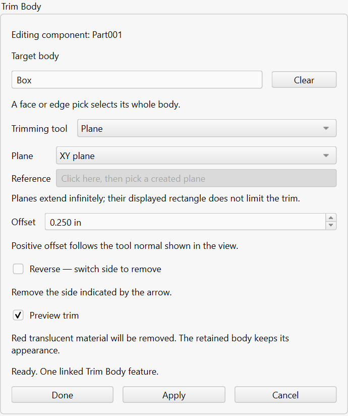

# Linear units across workflows — November 28, 2026

Owner request: allow entering linear dimensions in inches throughout the other
workflows, extending the prior body-pattern repair. Baseline: c7d6d188c6.

## Diagnosis and implementation

The remaining fixed-mm length field in `freecad_plus` was Trim Body's offset.
Actual keyboard entry of `0.25 in` stored 0.25 mm before the correction. It now
uses the existing QuantityNumber parser, commits pending input before Apply,
rejects incompatible dimensions, updates previews on committed edits, and stores
optional `offset_unit` presentation metadata in the existing TrimSettings recipe.
Old recipes without it remain millimeter-based. Geometry remains stored in mm.
Apply resets the offset and its presentation; edit restores the entered units.

This extends the existing approved quantity-entry behavior without changing task
layout, selection, geometry algorithms, angular controls, or dimensionless values.
No new UI design or native binary changes were needed.

## Audit and verification

| Workflow/control | Evidence |
| --- | --- |
| Extrude lengths and start/end offsets | Actual task widgets: keyboard inch parsing |
| Datum plane and sketch placement offsets | Actual task widgets: keyboard inch parsing |
| Shell and Thicken thickness | Actual task widgets: keyboard inch parsing |
| Reference image size, calibration and XYZ offsets | All six length controls, precise 1/32-inch entry |
| Sketch pattern spacing | Shared pattern amount control plus quantity regressions |
| Component instances | Every linear field across Quantity, Linear, Grid and Circular pages |
| Move/Rotate/Align distances | Source audit of native InputField creation and native parser keyboard test |
| Mesh from Shape | Main and Advanced Standard deviation, Mefisto maximum edge length, Gmsh min/max size |
| Body Mirror/Linear/Polar/Multi-transform | Existing five inch-entry regression tests |
| Fillet, Chamfer, Part primitives, native placement | Source audit: native QuantitySpinBox; bound-property parser/save-unit regression |
| Trim Body | Geometry, pending Apply, invalid units, reset, Undo/redo, save/reopen, in-place edit, Cancel and legacy recipes |

All 24 source checks and all 24 installed checks passed. Tests type inch values
through Qt keyboard events, then check native physical values. Collapsed task
controls are explicitly committed for parser coverage; this is distinct from
testing every task end-to-end. Trim and mesh tests also verify saved operation
results. Gmsh input units were verified; external Gmsh execution was not required.

Remaining ordinary double spin boxes in Plus are angular controls, dimensionless
direction components, and dimensionless mesh grading/element counts. They should
not accept inches. Appearance percentages and instance counts also retain their
own dimensions. Workflows without linear fields require no changes.

## Delivery

The existing FreeCADPlusScripts target copied three Python payloads. Their source,
build and installed hashes match. Owner settings and desktop shortcut hashes were
preserved. Tests used isolated profiles and generated documents, not owner files.
See install-manifest.json, the installed test log, and the direct screenshot:

